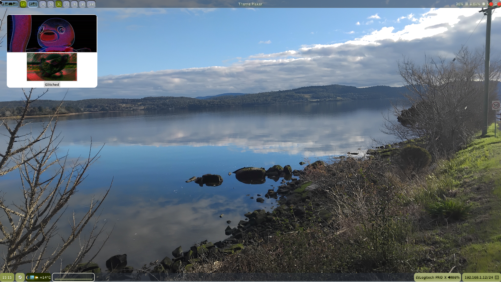
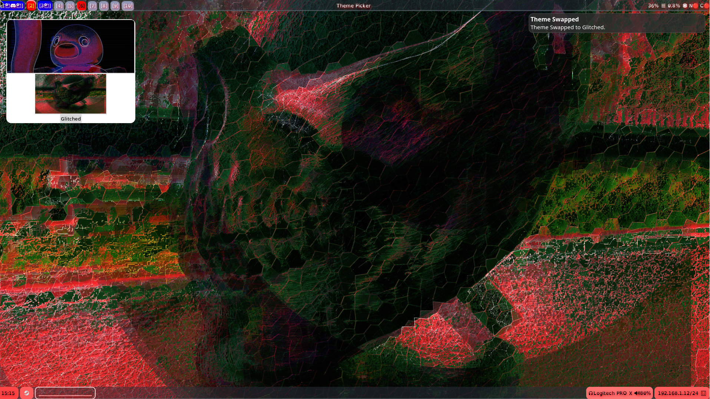

#Tkinter Python theme picker

Due to a nagging need to create and manage a bunch of different themes, I needed to make a theme picker to manage them. 

I have shared my code here as an example to reference.

Examples of the program in action:

